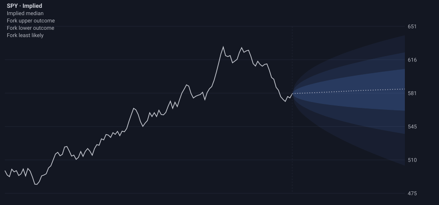
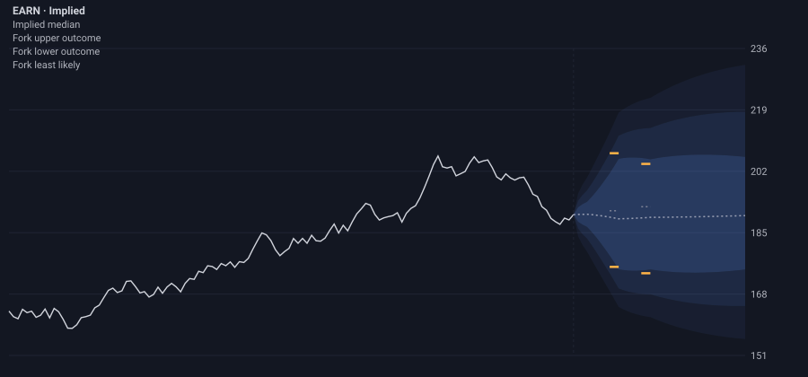

<p></p>

# Implied

**See where the options market actually thinks price is going, with the real shape of the bet: skewed, fat-tailed, and sometimes split in two.**

Implied is a free, open-source [TrendSpider](https://trendspider.com) custom indicator. It reads the live options chain, recovers the probability distribution the market is pricing for each expiry, and paints it into the future on the price chart as a cloud. Built for the 2026 TrendSpider Hackathon, category *Most Unique Options Indicator* (#TSBuild26).

| SPY: downside tail wider than upside | Two-outcome market: the Fork |
| --- | --- |
|  |  |

*Previews rendered from the script's own paint calls on synthetic chains (`npm run preview`); the Fork preview is a simulated two-outcome market.*

**Try it live: [implied.netlify.app](https://implied.netlify.app).** The home, Explore, Lab, Analyze, How-it-works and Validation pages run the real `dist/implied.js` in your browser against a stand-in for TrendSpider's runtime; the Fork page runs the same model code (`src/core.js`) directly. All of it on simulated chains, not market data.

| Page | What it does |
| --- | --- |
| [Explore](https://implied.netlify.app/symbol/?t=XERN) | A ticker page for each simulated chain: implied vs lognormal probability distribution with a probability table, projection cloud, volatility skew, expected move, Fork detection, and the option chain |
| [Lab](https://implied.netlify.app/lab/) | Shape a market (volatility, skew, an earnings jump, spreads) and watch the script repaint |
| [The Fork](https://implied.netlify.app/fork/) | Build a two-outcome market and watch the detector apply its three rules |
| [Analyze](https://implied.netlify.app/analyze/) | Drop a chain saved from TrendSpider and see what Implied would paint on it |
| [How it works](https://implied.netlify.app/how-it-works/) | Quotes → implied vol → fitted smile → density → cloud, one live chart per step |
| [Validation](https://implied.netlify.app/validation/) | Run the accuracy checks in the browser |
| [Install](https://implied.netlify.app/install/) | Install steps, settings and on-chart messages |
| [The script](https://implied.netlify.app/script/) | Read the whole of `implied.js`, then copy, download or open it raw |

## Install in TrendSpider

1. Open TrendSpider's Custom JS indicator editor and create a new indicator.
2. Paste the whole of [`dist/implied.js`](dist/implied.js) and save.
3. Add it to a **Daily** chart of any ticker with listed options. Options data needs TrendSpider's OPRA options add-on, bought in your TrendSpider account (see their [pricing page](https://trendspider.com/pricing/)).

## How to read it

| On the chart | Meaning |
| --- | --- |
| Dense core band | 25th–75th percentile: half the probability sits here |
| Middle bands | 10th–90th percentile: the 80% range |
| Faint outer bands | 2.5th–97.5th percentile: the 95% range |
| Dotted line | The median outcome |
| One side wider than the other | The market prices bigger moves in that direction. The summary panel says how much wider that side is, e.g. "Downside tail 1.4× upside" |
| Orange ticks (the Fork) | The market prices two separate outcomes, as before a binary event (an FDA decision, a deal vote). Rare by design: most earnings are priced as one wide range, with no Fork. The grey tick between them is the least likely zone. The summary panel reads e.g. "Fork: $182.00 / $201.00 · least likely $190.00" |

A summary panel (top left) shows a small chart of the distribution at the expiry that matters most, its median and 95% range, the skew in words, and the Fork prices. The median line's price shows on hover; the summary panel gives the 95% range in dollars.

This is the market's **risk-neutral** distribution: the price of each outcome. It includes risk premia, so it is not a guaranteed forecast of real-world odds.

## How it works

For each expiry, Implied:

1. **Cleans quotes.** Mid = (bid + ask) / 2; drops zero bids, inverted quotes and spreads wider than the setting (a spread of $0.05 or less is always kept, so cheap wing options on low-priced stocks still count).
2. **Finds the forward** F from put-call parity at the five strikes nearest spot (median), which absorbs dividends and borrow cost. The quoted last price is never used to place the cloud, so a stale or after-hours print cannot shift it.
3. **Solves implied volatility** (Black-76, bisection) on out-of-the-money quotes only. Puts below F are converted to calls with parity.
4. **Fits a smooth smile** of total variance w(k) = σ²T in log-moneyness k = ln(K/F). It uses a penalized smoothing spline, with each quote weighted by the noise its bid-ask spread implies. The smoothing strength is picked per chain by generalized cross-validation, so tight chains keep their detail and noisy ones are smoothed harder. The wings extend linearly within Lee's moment bound (|dw/dk| ≤ 2). A first fit flags quotes more than 5 noise units (or 3× the median) off the smile; they are dropped and the smile is refitted, so one bad print cannot make a false peak.
5. **Takes the density** by Breeden–Litzenberger, the discounted second derivative of the rebuilt call price in strike, on a 601-point log-strike grid. If the result has negative probability (butterfly arbitrage), the smile is smoothed harder until it does not; an expiry whose probability does not add up is skipped.
6. **Reads the shape:** quantiles; the skew ratio (q97.5 − q50) / (q50 − q2.5), exactly how much wider the cloud is drawn above the median than below it, so the sentence always matches the chart; the tail weights below 0.9·F and above 1.1·F; and the Fork. A Fork is two peaks each at least 25% of the tallest and at least 3% of F apart, with the valley between them below 70% of the smaller peak, and both peaks inside the quoted strikes (never in the extrapolated wings). The two peaks must also still be there, with a clear dip between them (valley under 92%), when the smile is refitted eight times smoother: a real two-outcome market is a broad "frown" in the smile, while a false peak from noisy quotes is a ripple that smoothing removes.
7. **Projects into the future.** Each quantile is carried as u = ln(q/F)/√T. That value is held flat before the first expiry and interpolated linearly in time between expiries, then re-expanded with √t. The cloud starts at the last close and widens like the square root of time. When the last close is within 10% of the chain's own spot (its nearest parity forward, discounted), the chain's forwards are drawn as they are, so a dividend or borrow cost before the first expiry stays in the cloud; further apart (a split, a chart left on an old session), the chain is rescaled onto the chart. Expiries drawn: the nearest one that models cleanly, the nearest to each target horizon (falling back to a neighbour when one is too thin), and any other expiry within 21 days that prices a Fork, so a post-earnings Fork is never lost between horizons.

### Design choices

| Choice | Instead of | Why |
| --- | --- | --- |
| GCV-tuned smoothing spline for the smile | A weighted cubic polynomial | A cubic cannot follow the IV "frown" a two-outcome market makes, so it cannot produce two peaks. With the spline, the stress run finds the Fork in 358 of 360 two-outcome expiries, with 0 false Forks in 1,950 one-outcome expiries. |
| u held at its first-expiry value before that expiry | u interpolated from 0 | Starting u at 0 and also scaling by √t makes the cloud grow like t^1.5, far too narrow in the first days (covered by a test in `test/project.test.js`). |
| Non-overlapping bands at 7% / 16% / 30% | Stacked fills | The same look, without painting over the core three times. |
| Text in one summary panel | A Fork label next to each expiry and a skew tag at the farthest one | Line names must stay fixed, and one panel in a fixed corner reads faster than labels scattered across the cloud. The panel also gives the median, 95% range and the chance of a 10% move. |
| Fork ticks separated by a gap | A tick at every forked expiry | On tickers with an expiry every weekday, a tick at each one merges into a long line; a tick that would touch the previous one is left out, so a run of daily Forks shows as short dashes every few bars. |

## Tested on real chains

On 2026-10-23 closing quotes (Cboe delayed data) for 22 tickers (SPY, QQQ, IWM, AAPL, MSFT, META, AMZN, GOOGL, TSLA, NVDA, AMD, NFLX, COIN, MSTR, GME, PLTR, SOFI, F, INTC, KO, XOM, BKNG), cut to TrendSpider's 40 strikes per side:

- Every chain drew a cloud, with no crashes, in 20 to 160 ms.
- **Against the market's own prices.** The probability of finishing below a strike, which a vertical spread between its neighbouring strikes prices with no model at all, matched Implied's to within half a point on most strikes. The largest gaps were all at the money, where the market's own spread estimates jump around: 0.2 to 1.2 points for NVDA, META, AAPL and SPY out to 28 days, and up to 2 points at 56 days (SPY 1.9, NVDA 2.0). The worst, TSLA 28-day (3.5 points), is a step in the market's numbers: its probability rises 2.7 points from $372.5 to $380, then 14 points to $390, which no smooth distribution follows. Reproduce with `node tools/model-vs-market.js <saved chain> 7 28 56`.
- **40 strikes per side.** For single stocks it covers every listed strike that matters, so results equal the full chain. For SPY and QQQ ($1 strikes) it covers about ±5%; the median and upside are unchanged, and the extrapolated lower tail runs 1 to 1.5 points of price wider at 28 to 56 days.
- **Earnings.** MSFT, AMZN and GOOGL reported inside the 7-day expiry (implied volatility 48 to 71%, against 17 to 25% before). Their market densities (butterfly prices) are wide and flat-topped, not split in two, and Implied correctly called no Fork. Large-cap earnings are usually priced as a wide range; the Fork appears when the market prices a true either/or outcome. A wider scan of 69 liquid tickers on the same close (228 expiries within 21 days) found no two-outcome market: 175 had one peak, 52 a second bump too small or too shallow to count, and 1 a borderline case that the smoothing check rejects.

Real quotes are licensed data and are not in this repository. To repeat the check on your machine: `npm run chain -- SPY` saves today's chain to the git-ignored `chains/` folder, then `node tools/replay.js chains/<file>` or `npm test` runs it.

## Known limits

- **40 strikes per side.** That is TrendSpider's maximum per request. With fine strike spacing, 80 strikes cover a narrow band: about ±5% for a $580 index ETF with $1 strikes, about ±10% for a $1,000 stock with $2.50 strikes. A Fork wider than that is not called, because the data gate sees too little of the distribution quoted, and the outer bands come from the fitted smile (the panel says so). Coarser listings (e.g. $5 strikes on a $190 stock) cover ±20% or more and are fine.
- **Bid and ask only.** The model needs live two-sided quotes. Outside market hours, if TrendSpider returns no bids, the chart shows "No live bid/ask quotes for X options right now (outside market hours?)" instead of a cloud.
- **Future bar units and chart types.** Whether TrendSpider's future bars are calendar or trading days, and what `close` holds on Heikin-Ashi charts, can only be confirmed in TrendSpider ([docs/verify-in-trendspider.md](docs/verify-in-trendspider.md)).
- **Risk-neutral.** The distribution is the price of each outcome, including risk premia, not a forecast of real-world odds.

## Settings

| Setting | Default | Range | Purpose |
| --- | --- | --- | --- |
| Expirations to project | 4 | 1–8 | Target horizons the cloud is drawn through (4: about 1 week, 2 weeks, 1 month, 2 months, plus the nearest expiry; 8 reaches about 3 months) |
| Risk-free rate (%) | 4.0 | 0–15 | Discounting in parity and pricing |
| Max bid-ask spread (fraction of mid) | 0.5 | 0.05–2 | Drops stale, illiquid quotes (a spread of $0.05 or less is always kept) |
| Min usable strikes per expiry | 8 | 5–60 | Skips expiries too thin to fit |
| Show Fork | On | On / off | Hides the Fork marks and the Fork line in the panel |

## On-chart messages

| Situation | What you see |
| --- | --- |
| Not a Daily chart | "Implied runs on the Daily timeframe only." |
| No listed options (crypto, most futures, forex), or no OPRA subscription | "No options data for X. Implied needs a ticker with listed options and an OPRA subscription." (plus the data error, if any) |
| No price history on the chart | "Implied needs price history on the chart." |
| An options request fails | The "No options data for X…" message, with the request's error in brackets |
| No expiry within the 100 bars the cloud can draw | "Options data for X did not include any expiration in the next 99 days." |
| The chain has no quotes for the expirations in the schedule | "Options data for X did not return quotes for the expirations in its schedule." |
| No bid anywhere in the chain (market closed, empty feed) | "No live bid/ask quotes for X options right now (outside market hours?). Implied needs two-sided quotes." |
| Every expiry too thin | "Not enough liquid strikes on X to build a distribution." |
| Some expiries thin or broken | Those expiries are skipped; the rest still draw |

## Development

Node 22+ and no runtime dependencies. The browser smoke test (`npm run smoke`) needs Playwright with Chromium.

```sh
npm test          # build dist/implied.js, then run all tests
npm run check     # fail if dist/implied.js is stale, then run all tests (CI and Netlify run this)
npm run stress    # thousands of synthetic expiries: Fork hit rate and false Forks
npm run preview   # render preview/index.html (dark + light) from the script's paint calls
npm run site      # build the website into public/ (deployed to Netlify)
npm run smoke     # open every built page in Chromium under the production CSP
npm run chain -- SPY                      # save a real chain (Cboe delayed quotes) to chains/, git-ignored
node tools/replay.js chains/<file>.json   # run a saved chain through the script
node tools/model-vs-market.js chains/<file>.json 7 28   # Implied's probabilities vs the market's own spreads
```

| Path | What it is |
| --- | --- |
| `src/core.js` | All math, pure functions: clean, IV, smile fit, density, shape, projection, labels |
| `src/indicator.js` | TrendSpider glue: settings, requests, paint calls |
| `dist/implied.js` | Built single file to paste into TrendSpider (committed) |
| `web/assets/engine.js` | Stand-in for TrendSpider's runtime (runs `dist/implied.js` unchanged, checks the API rules the script relies on, records paint calls; it is not TrendSpider itself, see `docs/verify-in-trendspider.md`) and synthetic chain generator; shared by the site, tests and tools |
| `test/runtime.js` | Test wrapper around the engine's runtime |
| `test/fixtures.js` | Synthetic chains priced from known distributions (smiles, two-outcome mixtures, illiquid) |
| `chains/` | Saved chains, replayed by the test suite. Only synthetic examples are committed: real OPRA chains are licensed data and are git-ignored |
| `web/` | Website: `pages/` (one file per page), `assets/` (styles, charts, browser engine, logo) |
| `tools/site.js` | Builds `web/` into `public/`; copies `dist/implied.js` and `src/core.js` so the site runs the real code; asset URLs carry a content hash |
| `docs/` | Store listing, TrendSpider verification steps, release checklist |

### Validation (synthetic chains with realistic bid-ask spreads and quote noise)

- Flat 25% smile: density within 2% of the analytic lognormal, integrates to 1 ± 0.001, median within 0.2% of F·e^(−σ²T/2).
- Skewed smile, 7–90 days: every band within 1 percentage point of probability of the true distribution.
- 50/50 outcomes 10% apart: both peaks within 1% of the true peaks, across 10 random quote sets; through the indicator's full path (data gate, smoothing check, 40 strikes a side) the Fork is drawn in 30 of 30 cases at 1–3% spreads.
- Earnings-style two-outcome chains (7–21 days, 40/60 to 60/40, spreads 1–5%): Fork found in at least 95% of 96 cases (the Validation page runs them and shows the count).
- One-outcome chains (index put skew, meme call skew, steep smiles, 3–90 days, noisy quotes): 0 false Forks (the Validation page runs them and shows the count).
- Stress run (`npm run stress`, also in CI; every chain cut to 40 strikes a side): Fork found in 358 of 360 two-outcome expiries; 0 false Forks in 1,950 one-outcome expiries (300 more were skipped as too thin, which is the intended outcome for unusable chains).
- A full run (selection, fits, paint calls) takes about 0.1–0.3 s in Node on a laptop; the test suite's budget is 3 s. One schedule request and one chain request per load.

## License

Apache-2.0. See [LICENSE](LICENSE).
